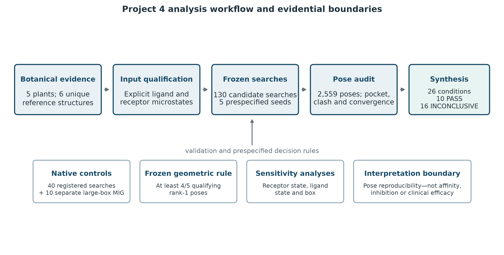
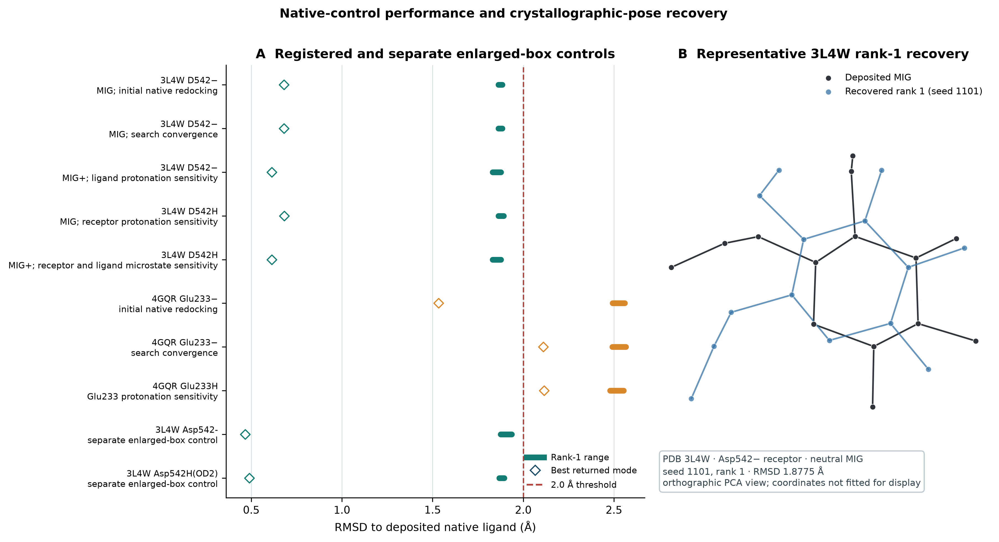
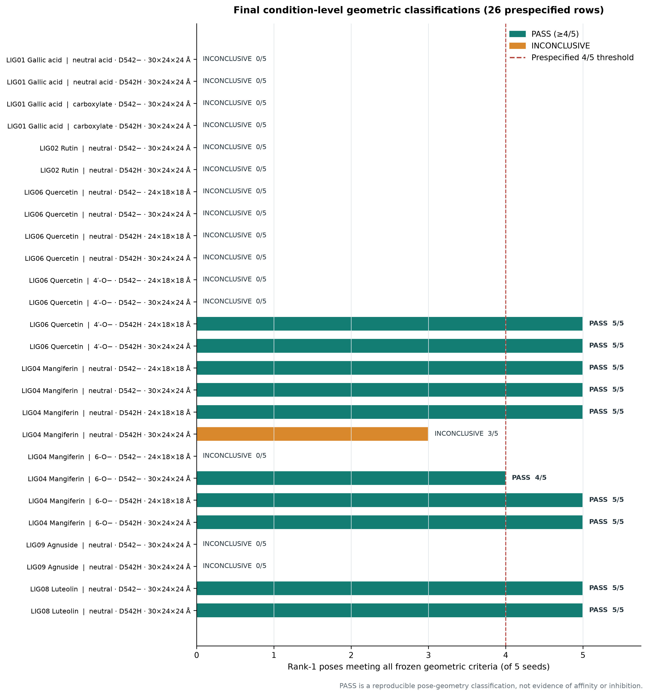
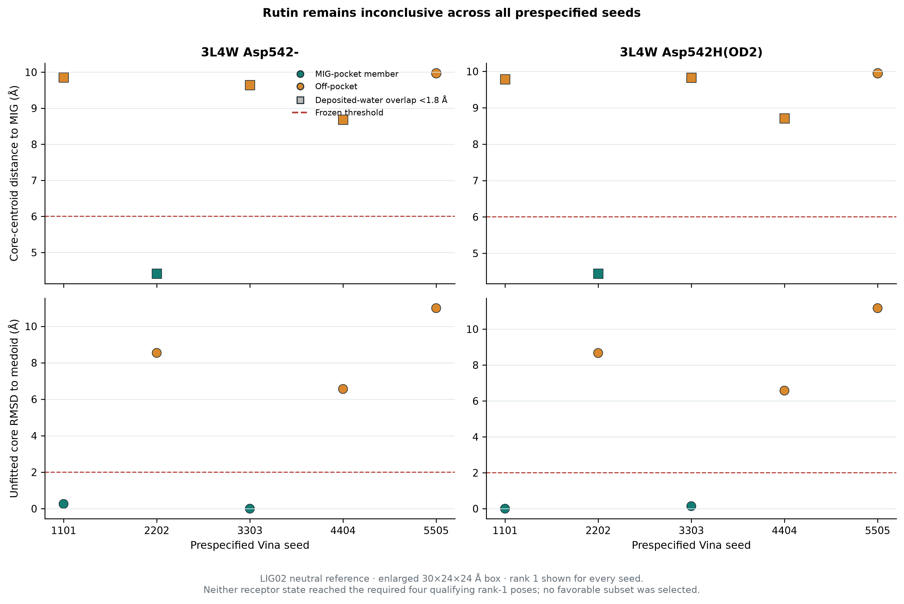
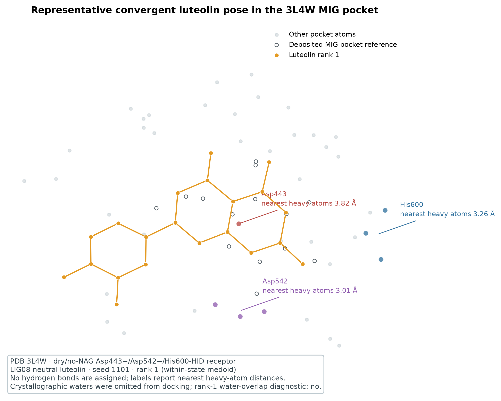
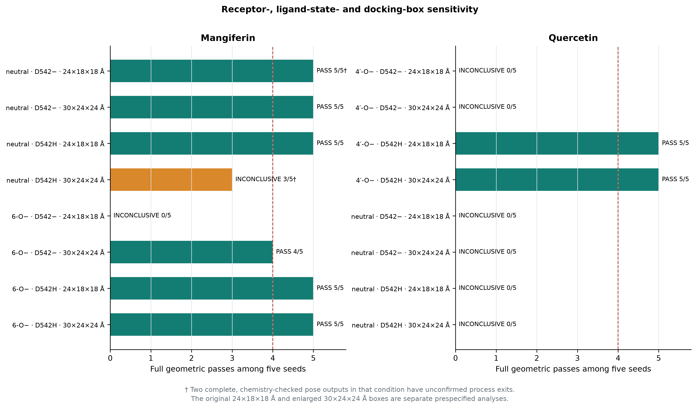

# Reproducible pose-geometry evaluation of six literature-associated phytochemicals at the human intestinal maltase-glucoamylase miglitol pocket

**Tharuniya Anpalakan**

Department of Applied Sciences, Northumbria University, Newcastle upon Tyne, United Kingdom

Correspondence: tharuniya08@gmail.com

## Abstract

**Background:** Polyherbal studies frequently connect extract-level biological measurements to named phytochemicals without demonstrating that those molecules occur in the tested extracts or that a docking score represents binding. This study developed a reproducible, deliberately restricted pose-placement analysis for six reference compounds associated in the literature with five medicinal plants: *Aegle marmelos*, *Boerhavia diffusa*, *Salacia reticulata*, *Senna auriculata* and *Vitex negundo*. The work addresses a possible human intestinal maltase-glucoamylase (ntMGAM) mechanism as a new computational hypothesis; it does not explain the glucose adsorption or yeast glucose-uptake assays in the preceding laboratory project.

**Methods:** Human ntMGAM structure 3L4W was modelled as two dry, N-glycan-omitted receptor protonation hypotheses differing at Asp542. Candidate reference structures comprised gallic acid, rutin, mangiferin, quercetin, agnuside and luteolin, with explicitly labelled alternative ionization hypotheses where prospectively justified. A deposited miglitol (MIG) pose defined the pocket and supported native-redocking controls. AutoDock Vina 1.2.7 searches had frozen boxes, exhaustiveness, output settings and five seeds. A condition was classified PASS only when at least four of five rank-1 poses met every prespecified criterion: containment within the box, rigid-core localization relative to MIG, absence of severe receptor or internal clashes, and no more than 2.0 Å unfitted symmetry-aware rigid-core RMSD from the within-condition medoid. Box-face margins and overlap with deposited crystallographic-water positions were reported diagnostically. All classifications were regenerated from archived records by a deterministic Python workflow.

**Results:** The candidate archive contains 130 analyzable searches and 2,559 poses. Process exit zero was documented for 126 searches; four mangiferin searches have complete, chemistry-checked outputs but unconfirmed process exits. The registered native-control set contains 40 searches: 25 for 3L4W and 15 for 4GQR. Ten additional 3L4W MIG searches assessed the separate enlarged-box condition, giving 50 archived native-control calculations in total without treating the enlarged-box runs as part of the registered 40. The final synthesis contains 26 ligand-state/receptor-state/box rows: 10 PASS and 16 INCONCLUSIVE. Neutral luteolin passed in both receptor states (5/5 each). Quercetin passed only for the modelled 4′-O monoanion with Asp542H(OD2) (5/5 in both boxes); all neutral-quercetin and Asp542− monoanion conditions were inconclusive. Mangiferin classifications depended on ligand state, receptor state and box. Gallic acid, rutin and agnuside remained inconclusive. The enlarged box removed most box-face warnings but changed two of eight mangiferin/quercetin condition classifications, demonstrating model sensitivity. The 3L4W native control recovered rank-1 MIG poses below 2.0 Å in all tested conditions, whereas the 4GQR α-amylase control failed its rank-1 criterion and was not used for candidate screening.

**Conclusions:** The analysis establishes a reproducible record of where rank-1 pose geometry was or was not stable under the tested hypotheses. PASS denotes consistency with a frozen geometric screen, not validated affinity, enzyme inhibition, botanical occurrence in the original extracts, antidiabetic efficacy or clinical relevance. The strongest next experiment is targeted chemical profiling of the original aqueous leaf extracts, followed by biochemical testing of analytically confirmed constituents.

**Keywords:** AutoDock Vina; maltase-glucoamylase; molecular docking; phytochemicals; reproducibility; pose convergence; protonation-state sensitivity; medicinal plants

## Introduction

Human intestinal carbohydrate digestion provides several plausible molecular targets for investigations related to postprandial glucose handling. The C-terminal and N-terminal domains of maltase-glucoamylase contain glycoside-hydrolase family 31 active sites, and crystallographic studies have described substrate recognition and inhibitor binding in these domains [1–3]. The ntMGAM structure deposited as Protein Data Bank (PDB) entry 3L4W contains miglitol (MIG) in the catalytic pocket and therefore provides a direct native-ligand reference for a pose-placement study [3]. Human pancreatic α-amylase is another relevant digestive enzyme, but a target is useful for docking only when its preparation and native control are adequate for the intended question. Structural availability alone does not validate a screening workflow.

Docking can suggest geometrically plausible placements, but its scores are approximate and highly dependent on receptor preparation, ligand protonation, search-space definition and sampling [4–8]. In particular, protonation and tautomer choices can change both generated poses and ranking [8]. A nominally favourable score does not establish equilibrium affinity, inhibition, bioavailability or biological efficacy [9]. These distinctions become especially important in natural-products research, where the modelled molecule may be inferred from an independent paper rather than measured in the experimental material. Botanical provenance, chemical identity, computational input identity and biological activity are separate evidential layers.

The five plants considered here—*Aegle marmelos*, *Boerhavia diffusa*, *Salacia reticulata*, *Senna auriculata* and *Vitex negundo*—originated from an undergraduate investigation of polyherbal aqueous leaf extracts. That laboratory work measured antioxidant endpoints, glucose adsorption and yeast glucose uptake. It did not chemically identify the six molecules modelled here, and it did not perform α-glucosidase, maltase-glucoamylase or α-amylase inhibition assays. The present docking study consequently tests a new structural hypothesis rather than supplying a mechanism for the original observations.

Candidate selection used compound-specific literature where possible and preserved extraction-method limitations. Gallic acid and rutin were associated with *A. marmelos* through authenticated leaf studies employing ethanol, methanol or hydroalcoholic extraction rather than the original water-only preparation [10,21]. Quercetin was associated with *B. diffusa* through a boiled-water leaf HPLC-DAD report, with supporting HPLC-PAD-MS/MS context [11,12], and with *S. auriculata* through isolation from aqueous-acetone leaves [14]. The same quercetin molecular calculations therefore represent one shared reference compound, not two independent docking experiments. Mangiferin had published water-leaf analytical support for *S. reticulata* [13]. Agnuside and luteolin were linked to *V. negundo*, but direct equivalence to the original aqueous extract was not demonstrated: the agnuside literature includes an abstract-level water comparison and a methanol-first analytical procedure, while the luteolin study used organic-solvent extraction [15–17]. None of these sources demonstrates the compounds in this project's original mixed extracts.

The principal aim was to determine whether rank-1 placements of these defined reference structures were reproducible within the MIG pocket under frozen geometric criteria. The working hypothesis was that a genuinely stable placement under the tested rigid model would recur in at least four of five prespecified searches and would remain interpretable when receptor Asp542 state, selected ligand ionization and box size were exposed as sensitivity variables. Secondary aims were to retain negative and ambiguous findings and make every classification regenerable from archived outputs. The study was designed around condition-level convergence rather than score ranking. This distinction is central: a consistent pose hypothesis may justify targeted follow-up, while an inconsistent pose requires caution, but neither result substitutes for chemical or biochemical measurement.

**Figure 1. Project 4 analysis workflow and evidential boundaries.** Literature-associated reference structures passed through explicit chemical-input qualification, frozen Vina searches, pose-level geometric auditing and deterministic synthesis. Candidate counts refer to 130 archived searches and 2,559 returned poses. Native controls comprise 40 registered searches plus 10 separate enlarged-box 3L4W MIG searches. PASS required at least four of five qualifying rank-1 poses and is not a statement of binding, inhibition or clinical efficacy.

## Methods

### Study design, evidence boundaries and compound set

The computational design was prospective at each executable stage. Source evidence was first classified by plant part, extraction solvent and analytical identification strength. Chemical inputs were assigned stable ligand identifiers and PubChem-backed reference structures. The final synthesis includes six unique molecules across five plants: LIG01 gallic acid and LIG02 rutin for *A. marmelos*; LIG06 quercetin shared by *B. diffusa* and *S. auriculata*; LIG04 mangiferin for *S. reticulata*; and LIG09 agnuside plus LIG08 luteolin for *V. negundo*. Because the same quercetin coordinates and searches underlie two botanical associations, quercetin was counted once computationally. Literature occurrence was not treated as evidence of occurrence in the original project extracts.

| Plant association | Modelled reference structure(s) | Evidence boundary |
|---|---|---|
| *Aegle marmelos* | Gallic acid; rutin | Compound-specific leaf evidence from organic or hydroalcoholic extracts; not verified in the original aqueous extract |
| *Boerhavia diffusa* | Quercetin | Published boiled-water leaf HPLC-DAD assignment with analytical qualification; same molecular experiment shared with *Senna* |
| *Salacia reticulata* | Mangiferin | Published water-leaf HPLC evidence; source-level stereochemistry and bound microstate remain conditional |
| *Senna auriculata* | Quercetin | Leaf isolation after 80% aqueous-acetone extraction and fractionation; not a water-only match |
| *Vitex negundo* | Agnuside; luteolin | Agnuside water-specific detail incomplete; luteolin supported by organic-solvent leaf HPLC, not water-only extraction |

### Target selection and native-control gate

PDB 3L4W was selected because human ntMGAM author chain A contains deposited MIG (residue A1001) in the catalytic pocket [3]. The 2.00 Å structure supplied the native-ligand coordinates and reference location for candidate rigid-core measurements. Five alternate-location residues were resolved by highest mean occupancy, with alphabetical selection on a tie. Missing residues 1–6, Gln837 and 871–875 were not modelled; the 836/838 chain break was retained, and the preparation check identified no missing standard side-chain heavy atoms. Candidate receptors omitted deposited MIG, six linked N-acetylglucosamine residues, four glycerols and all crystallographic waters; no deposited catalytic ion was present. Water and glycan omission was a controlled rigid-receptor approximation, not a claim that they are biologically irrelevant.

Provisional hydrogens were placed with OpenMM 8.6.1 [27]. A PROPKA 3.5.1 review at the crystallization-record pH of 6.5 gave model-dependent Asp542 estimates that differed between apo and neutral-MIG contexts; these estimates were used to motivate sensitivity testing, not to assign the bound protonation state [26]. Two explicit receptor hypotheses were therefore retained: Asp443−/Asp542−/His600-HID and Asp443−/Asp542H(OD2)/His600-HID. For the protonated variant, Meeko's ASH template was used, the OpenMM-directed OD2 hydrogen was normalized to a 0.98 Å O–H distance, and heavy-atom coordinates were unchanged. Meeko 0.8.0 generated receptor PDBQT files with template/Gasteiger charges; 6,912 matched heavy atoms in the two final variants agreed with the prepared coordinates to approximately 0.001 Å. These structures are computational hypotheses, not experimentally determined bound-state assignments.

The registered native-control set comprised eight five-seed conditions (40 searches). Five conditions belonged to 3L4W (25 searches): initial neutral-MIG/Asp542− redocking at exhaustiveness 32, a neutral-MIG/Asp542− convergence condition at exhaustiveness 64, protonated-amine MIG with Asp542−, neutral MIG with Asp542H(OD2), and the combined protonated-amine MIG/Asp542H(OD2) condition. The last four used exhaustiveness 64. All 25 registered 3L4W searches recovered a rank-1 pose within 2.0 Å of deposited MIG. For the initial neutral-MIG/Asp542− condition, rank-1 RMSDs ranged from 1.8629 to 1.8849 Å. More crystal-like modes were sometimes lower ranked; the best recovered initial mode was 0.6806 Å at rank 2.

The registered set also contained three 4GQR conditions (15 searches), described below. Separately, a later enlarged-box control used neutral MIG in both 3L4W receptor states, five seeds per state, at exhaustiveness 64. These 10 distinct calculations used the 30 × 24 × 24 Å candidate box and retained 10/10 rank-1 native recoveries. Thus, the archive contains 40 registered controls plus 10 separate enlarged-box controls, or 50 native-control calculations in total. The two scopes are not pooled as replicates, and the enlarged-box calculations are not retroactively counted in the registered control table.

PDB 4GQR was separately assessed as a human pancreatic α-amylase target using author chain A and deposited ligand MYC A504 [18]. The dry receptor retained Ca A502, Cl A503 and terminal PCA A1, omitted one distant N-acetylglucosamine residue and removed waters after the provisional-hydrogen check. The reference hypothesis at pH 7.5 was Asp197−/Glu233−/Asp300−/His201-HID; a separate Meeko GLH preparation protonated Glu233 on OE2. Neutral MYC was used in all three registered conditions: the initial search at exhaustiveness 32, increased-search convergence at 64, and Glu233-protonation sensitivity at 64. The box centre was (13.44317391, 15.13530435, 39.43613043) Å with dimensions 26 × 24 × 28 Å. None of the 15 rank-1 poses was within 2.0 Å. One initial-search mode reached 1.5328 Å only at rank 17. Because the frozen gate concerned rank-1 recovery, 4GQR was suspended for production use and no candidate compound results were generated for that receptor. The treatment of retained Ca/Cl ions by the scoring model was not independently validated.

**Figure 2. Native-control performance and crystallographic-pose recovery.** (A) Observed rank-1 RMSD ranges and best returned modes for the eight registered control conditions and two separate enlarged-box 3L4W MIG conditions. Horizontal bars span observed rank-1 minima to maxima; white diamonds mark the best returned mode. No midpoint or mean is plotted. The red line marks the prespecified 2.0 Å rank-1 threshold. Every 3L4W condition passed; all three 4GQR conditions failed. (B) Deposited MIG and the rank-1 pose from seed 1101, selected as the median rank-1 RMSD among the five initial 3L4W neutral-MIG runs. The orthographic principal-component projection is a display-only projection of unchanged coordinates; the RMSD calculation used original crystal-frame coordinates without fitting. PDB 3L4W, Asp542− receptor, neutral MIG, seed 1101, rank 1, RMSD 1.8775 Å.

### Ligand and receptor hypotheses

Each ligand was preserved as a named structural hypothesis. PubChem reference records were CID 370 (gallic acid), 5280805 (rutin), 5281647 (mangiferin), 5280343 (quercetin), 5280445 (luteolin) and 442416 (agnuside). Gallic acid was assessed as the neutral acid reference and a pH-6.5 carboxylate hypothesis; acid–base literature supports ionization as a relevant question but does not determine the protein-bound state [25]. Mangiferin was assessed as the neutral keto reference and a modelled xanthone 6-O monoanion, motivated by an aqueous acid-dissociation study [22]. Quercetin was assessed as the neutral keto reference and a modelled flavonol 4′-O monoanion; published quercetin acid–base and radical studies support sensitivity to deprotonation but do not uniquely establish the selected bound regioisomer [23,24]. Rutin, agnuside and luteolin were assessed only as neutral reference structures. Alternative phenolate sites or tautomers were not silently substituted. Rutin and agnuside retain reference glycosidic stereochemistry, but this does not prove the exact stereoform in a botanical sample.

Ligand three-dimensional records were generated with RDKit 2026.03.6 [19]. ETKDGv3 used a fixed seed of `20261011 + ligand number`, one thread and no pruning; 24 conformers were requested for smaller molecules and 60 for glycosides. Conformers underwent MMFF94s optimization for up to 1,000 iterations. Formula, formal charge, graph connectivity and available stereochemistry were checked with explicit hydrogens. Meeko 0.8.0 then generated flexible-ligand PDBQT records with Gasteiger charges, and atom-map/PDBQT round trips were checked [20]. File hashes, source record, selected conformer and charge were recorded before docking.

Neutral mangiferin and quercetin used the lowest stored MMFF conformer (source record 1). Their anions were constructed by removing the specified 6-OH or 4′-OH hydrogen while preserving heavy-atom coordinates; they were not re-minimized and are not presented as equilibrium microstate populations. Gallic acid used neutral source record 1 (source conformer 19); its carboxylate was generated by removing the carboxyl hydrogen and separately minimizing the ionized structure with MMFF94s. Neutral luteolin used source record 1 for all seeds. Rutin used source records 1, 4, 5, 3 and 9 for seeds 1101, 2202, 3303, 4404 and 5505, respectively; agnuside used records 1, 5, 8, 11 and 17. Consequently, conformer identity and docking seed are confounded for rutin and agnuside, and their five searches cannot separate initial-conformer from stochastic-search effects.

Deterministic ligand starts used NumPy PCG64 quaternion rotations and translations while requiring a quaternion norm of at least 2 and at least 0.5 Å clearance from each box face. Mangiferin and quercetin used a `SeedSequence` keyed by seed, PubChem CID and charge-state code with translations within ±3 Å; the other ligand pilots retained their archived deterministic start rules. The same start for a given seed was used across the two 3L4W receptor states. The receptor remained rigid; Vina sampled ligand torsions only. Receptor side-chain movement, explicit solvent, induced fit and covalent chemistry were outside scope.

### Frozen search protocol

All candidate searches used AutoDock Vina 1.2.7 with the Vina scoring function, exhaustiveness 64, 20 requested modes, an energy range of 5.0 kcal/mol, minimum output RMSD of 1.0 Å, one CPU and seeds 1101, 2202, 3303, 4404 and 5505 [4,5]. The box centre was the deposited-MIG heavy-atom centroid at (45.38664286, 92.35157143, 34.82200000) Å. The original mangiferin/quercetin pilot used 24 × 18 × 18 Å. A single prospectively defined box-adequacy analysis used 30 × 24 × 24 Å. Later gallic acid, rutin, agnuside and luteolin pilots used the enlarged box. Searches were not repeated to replace an unfavourable scientific outcome.

The archive contains 130 analyzable candidate searches. Of these, 126 have a recorded zero process exit. Four mangiferin searches have complete MODEL/ENDMDL pose sets, valid chemistry and matching output hashes but no confirmed process exit after timeout: neutral mangiferin/Asp542− seeds 2202 and 4404 in the original box, and neutral mangiferin/Asp542H(OD2) seeds 2202 and 3303 in the enlarged box. They remain explicitly qualified rather than retroactively relabelled. Fourteen enlarged-box quercetin launches that immediately reported insufficient memory were retained as technical failed attempts; separately named retries used unchanged scientific parameters at lower concurrency and completed with exit zero. These failed launches are not counted as additional scientific searches.

### Frozen geometric classification

The primary unit of inference was a ligand-microstate/receptor-state/box condition containing five prespecified rank-1 poses. A rank-1 pose qualified only if: (1) all ligand heavy atoms lay within the box; (2) the frozen rigid-core centroid was no more than 6.0 Å from the deposited-MIG centroid; (3) at least half of rigid-core atoms lay within 4.0 Å of a MIG heavy atom; (4) no receptor–ligand heavy-atom distance was below 1.8 Å and no van der Waals overlap exceeded 0.8 Å; (5) no specified nonbonded internal heavy-atom distance was below 1.6 Å; and (6) its symmetry-aware, unfitted rigid-core RMSD to the within-condition rank-1 medoid was no more than 2.0 Å. The medoid minimized the summed pairwise core RMSD among the five rank-1 poses, with the smaller seed resolving a tie. The condition-level classification was PASS when at least four of five rank-1 poses qualified; otherwise it was INCONCLUSIVE. Thresholds were not adjusted after observing outcomes.

Native controls used a distinct validation metric: symmetry-aware, all-heavy-atom RMSD to the deposited ligand in the crystal coordinate frame, with no molecular fitting. MIG and MYC comparisons used 14 and 23 heavy atoms, respectively. The rank-1 native criterion was no more than 2.0 Å. Candidate rigid-core convergence and native all-heavy-atom recovery therefore answer different questions and were not interchanged.

The nearest box-face margin was diagnostic; a margin below 1.0 Å produced a warning but was not itself a failure criterion. For gallic acid, rutin, agnuside and luteolin, pose coordinates were also compared with deposited 3L4W crystallographic-water oxygen positions. A separation below 1.8 Å was labelled a deposited-water overlap. Because the docking receptors were dry and waters can be displaced or structurally important, this diagnostic is neither a clash proof nor an energetic penalty. No per-pose water audit was available for the original mangiferin/quercetin experiments, and none was inferred.

### Reproducibility and figure generation

Run-level CSVs, all-pose metrics, attempt JSON records, manifests and frozen outputs were checked by automated tests. The final 26-row CSV is generated deterministically from the archived analyses and has SHA256 `5e3168dd3e5ed289e53eb8b48922a4c809a942f6b80a8dd7f294f184b20da3a1`. Publication figures were generated by `scripts/build_project4_manuscript_figures.py` using Python 3.12.10, Matplotlib 3.11.2, NumPy 2.5.4, Meeko 0.8.0 and RDKit 2026.3.6. Each figure was exported as 300-dpi PNG and editable SVG. A machine-readable provenance table records input paths, SHA256 values, selection rules and structural identifiers. Structural panels preserve archived coordinates and do not assign hydrogen bonds from proximity.

## Results

### Archive completeness and overall classification

The candidate archive comprised 130 analyzable searches and 2,559 returned poses, with complete output files for every search. There were 126 confirmed exit-zero searches and four complete-output searches with unconfirmed exits. Native validation comprised 40 registered searches (25 for 3L4W and 15 for 4GQR) plus 10 separate enlarged-box 3L4W MIG searches, for 50 archived native-control calculations in total. The deterministic synthesis produced 26 unique combinations of ligand structure, ligand microstate, receptor state and box. Ten combinations met the frozen four-of-five rule; 16 were inconclusive. No rank-1 pose was rejected for a severe receptor clash. Six severe clashes occurred among lower-ranked poses in the original 781-pose mangiferin/quercetin dataset, and none occurred in the 798-pose enlarged-box comparison.

**Figure 3. Final condition-level geometric classifications.** Every row in the authoritative 26-row synthesis is shown. Bars report the number of five rank-1 poses satisfying all frozen criteria; the dashed line is the required four-of-five threshold. The 10 teal conditions are PASS and the 16 orange conditions are INCONCLUSIVE. Zero-length bars remain labelled so negative results are visible. PASS describes pose geometry only.

### Gallic acid, rutin and agnuside

All four gallic-acid conditions were inconclusive, including neutral-acid and carboxylate hypotheses in both receptor states. Each had zero pocket-localized rank-1 poses and zero full geometric passes. All 20 rank-1 gallic-acid poses occupied an off-pocket site at the negative Z box face and overlapped deposited water positions within 1.8 Å. The first lower-ranked MIG-pocket alternatives did not show those water overlaps, but the frozen decision rule was rank-1 based and the alternatives did not convert the conditions to PASS. These observations indicate sensitivity to ranking and an incompletely characterized off-pocket site rather than evidence that the molecule cannot interact with the protein.

Rutin also remained inconclusive in both receptor states. Each condition had one of five rank-1 poses satisfying the initial pocket-localization requirement but zero full geometric passes. The qualifying-pocket seed was 2202 in each receptor state, yet its unfitted core RMSD to the condition medoid exceeded 8.5 Å. The medoid rank-1 poses were themselves off-pocket. Four of five rank-1 poses in each receptor state overlapped deposited-water positions below 1.8 Å. Across all ranks, 44 of 200 rutin poses entered the MIG pocket, 42 of them below rank 1; therefore, the result reflects poor rank-1 localization and convergence, not absence of any pocket placement.

**Figure 6. Rutin remains inconclusive across all prespecified seeds.** Rank-1 core-centroid distance to MIG and unfitted core RMSD to the within-state medoid are shown for all five seeds in both receptor states. Squares identify rank-1 poses overlapping a deposited crystallographic-water position within 1.8 Å. The red lines mark the 6.0 Å localization and 2.0 Å convergence thresholds. No favourable subset was selected.

Agnuside was inconclusive in both receptor states with zero pocket-localized rank-1 poses and zero full passes. Every rank-1 pose, and 186 of 200 returned modes overall, overlapped a deposited-water position within 1.8 Å. The pervasive diagnostic overlap reinforces the need for explicit-solvent or water-retention reasoning in any future follow-up, but it cannot determine whether a water would remain, move or be displaced.

### Luteolin

Neutral luteolin was the most internally stable reference under the tested conditions. Both Asp542− and Asp542H(OD2) conditions passed with 5/5 pocket-localized, clash-free and convergent rank-1 poses. Mean rank-1 Vina scores were −7.948 and −8.174 kcal/mol, respectively, but these values were not used to classify the conditions or compare potency. Rank-1 core RMSDs to the medoid ranged from 0 to 0.0592 Å for Asp542− and 0 to 0.0295 Å for Asp542H(OD2). No rank-1 luteolin pose overlapped a deposited water below 1.8 Å, although 43 of 99 and 40 of 99 total returned modes did so in the two receptor states. Only the neutral luteolin reference was tested; the result does not generalize to phenolate states.

**Figure 4. Representative convergent luteolin pose in the 3L4W MIG pocket.** The displayed pose is the frozen within-condition rank-1 medoid: PDB 3L4W, neutral LIG08, Asp443−/Asp542−/His600-HID receptor, seed 1101, rank 1. Deposited MIG is shown as an unfilled pocket reference. Labels give nearest heavy-atom distances to Asp443, Asp542 and His600; they do not assign hydrogen bonds. Crystallographic waters and N-glycans were omitted from docking. The rank-1 deposited-water-overlap diagnostic was negative. Coordinates were projected without pose fitting.

### Quercetin and mangiferin sensitivity

Quercetin showed a sharply microstate- and receptor-dependent pattern. Neutral quercetin was inconclusive in both receptor states and both boxes, with zero pocket-localized and zero fully qualifying rank-1 poses in all four conditions. The modelled 4′-O monoanion also remained inconclusive with Asp542− in both boxes. In contrast, the monoanion/Asp542H(OD2) combination passed 5/5 in both the original and enlarged boxes. This pattern is a conditional result for one specified phenolate regioisomer and one receptor protonation hypothesis. It does not establish that either state is populated in solution or in the enzyme, and it cannot be treated as experimental evidence for quercetin binding.

Mangiferin produced six PASS and two INCONCLUSIVE classifications across eight conditions. Neutral mangiferin passed 5/5 with Asp542− in both boxes and with Asp542H(OD2) in the original box. With Asp542H(OD2) in the enlarged box, all five rank-1 poses were pocket localized but only three met the medoid-convergence rule, so the condition was inconclusive. The 6-O monoanion/Asp542− condition changed from 0/5 and inconclusive in the original box to 4/5 and PASS in the enlarged box. The monoanion/Asp542H(OD2) condition passed 5/5 in both boxes. These directionally different changes show why a single box should not be interpreted as a chemically definitive result.

**Figure 5. Receptor-, ligand-state- and docking-box sensitivity for mangiferin and quercetin.** All 16 conditions are displayed. The original box was 24 × 18 × 18 Å and the enlarged box was 30 × 24 × 24 Å. The dagger marks conditions containing two complete, chemistry-checked pose outputs whose process exits remain unconfirmed. Classification used geometry, not Vina score.

The box analysis also clarified a methodological artefact. In the original 40-run mangiferin/quercetin pilot, 36 rank-1 poses lay within 1.0 Å of a box face. Only one of 40 enlarged-box rank-1 poses did so. Despite improved margins and successful native controls in the enlarged volume, two of eight condition-level classifications changed. Thus, box enlargement reduced truncation warnings but did not make the candidate conclusions box independent.

### Five-plant synthesis

For *A. marmelos*, both gallic acid and rutin remained inconclusive; their literature associations do not verify either molecule in the original aqueous leaf extract. For *B. diffusa* and *S. auriculata*, the shared quercetin reference yielded no independent plant-specific experiment: only the 4′-O monoanion/Asp542H hypothesis passed, while all neutral conditions were inconclusive. For *S. reticulata*, mangiferin produced several stable pose conditions but also meaningful box and protonation dependence. For *V. negundo*, agnuside was inconclusive and neutral luteolin passed in both receptor states. The apparent contrast between agnuside and luteolin is a contrast between modelled reference structures and conditions, not evidence that one plant constituent is more efficacious than another.

## Discussion

This study's main contribution is not a ranking of phytochemicals; it is a traceable demonstration of how pose conclusions change when receptor state, ligand state and search-space boundaries are treated as explicit hypotheses. Ten of 26 conditions satisfied a demanding, prespecified convergence rule. The distribution of those passes was chemically structured rather than uniform: neutral luteolin was stable across both receptor hypotheses; quercetin required the joint 4′-O monoanion/Asp542H model; mangiferin depended on both ionization and box; and the three other references did not achieve condition-level convergence. These outcomes provide testable structural hypotheses but cannot determine which chemical states exist in the assay or which molecules are present in the source material.

The native controls support limited confidence in 3L4W pose placement. Rank-1 MIG recovery was reproduced for neutral and protonated ligand hypotheses, both receptor states and both search volumes. However, the more crystal-like initial poses frequently appeared at rank 2, illustrating an imperfect relationship between Vina ranking and experimental similarity. The failed 4GQR control is equally informative. Retaining that negative result prevented candidate screening on a target whose current preparation did not recover the deposited ligand at rank 1. A workflow that reports only successful targets would conceal an important method limitation.

The quercetin result illustrates the danger of converting a microstate sensitivity result into a biological claim. The neutral reference was consistently off-pocket, whereas one modelled phenolate passed only with Asp542H. Standard Vina scoring does not validate proton-coupled binding thermodynamics, and the chosen 4′ site is not proven to be the dominant solution or bound regioisomer. The correct inference is that pose placement is conditional on the paired input states. A useful follow-up would compare experimentally or quantum-chemically justified microstate ensembles under a prospectively registered protocol, not select the state that produced a favourable docking pattern.

Mangiferin demonstrates a second form of fragility. Enlarging the box corrected widespread face-margin warnings, yet it changed one condition from inconclusive to PASS and another from PASS to inconclusive. The first change is consistent with the original box having constrained sampling for the monoanion/Asp542− pair, but the comparison does not by itself establish a unique cause. The second arose because enlarged-box neutral mangiferin/Asp542H produced pocket-localized rank-1 poses that did not converge sufficiently around one medoid. Both findings are scientifically useful because they expose dependence on a modelling choice. Neither justifies choosing the box that gives the preferred classification.

Rutin, agnuside and gallic acid show why lower-ranked pocket poses and score magnitude were not allowed to override the primary rule. Rutin had many lower-ranked pocket modes and comparatively negative Vina scores, yet its rank-1 poses were mostly off-pocket and geometrically inconsistent. Gallic acid's ranked solutions repeatedly occupied a box-face, water-overlapping site, while later pocket modes did not meet the prespecified rank-1 criterion. Agnuside showed extensive overlap with positions occupied by deposited waters. Reporting these patterns as inconclusive preserves possible alternative hypotheses without presenting them as verified binding modes.

The botanical layer further constrains interpretation. The computational panel was assembled from external occurrence literature of varying solvent and analytical strength. It was not derived from chromatography or mass spectrometry of the original five aqueous leaf extracts. Even the strongest independent water-leaf reports concern other samples, collection histories and preparation procedures. Consequently, docking cannot connect an unmeasured compound to the original DPPH, ABTS, glucose-adsorption or yeast-uptake results. Nor can separate ligand calculations demonstrate mixture synergy. Synergy would require an explicit combination design, dose-response data and an appropriate interaction model.

## Limitations

First, experimental repeatability and biological validity were not established. No new wet-laboratory assay was conducted, none of the six compounds was quantified in the original extracts, and there is no direct ntMGAM inhibition measurement for the project samples. The model therefore cannot support therapeutic, antidiabetic or clinical-efficacy claims.

Second, receptor chemistry was simplified. The receptor was rigid, linked N-glycans and crystallographic waters were omitted, and only two Asp542 states with His600-HID were considered. Other protonation networks, side-chain conformations, induced fit, metal or buffer effects, and explicit solvation could alter pose placement. Water overlaps are coordinate diagnostics rather than energetic determinations.

Third, ligand chemistry was incompletely sampled. Only selected microstate hypotheses were prepared. Rutin and agnuside are flexible glycosides whose conformer coverage may be insufficient for their bound ensembles. Neutral luteolin passed, but phenolate alternatives were not tested. The mangiferin 6-O and quercetin 4′-O anions are labelled hypotheses, not measured bound states. Reference stereochemistry does not prove botanical stereoidentity.

Fourth, the native control is limited. MIG redocking supports recovery of one co-crystallized ligand in 3L4W, but it does not validate ranking across diverse phytochemical scaffolds or predict affinity. The 4GQR failure restricts the project to ntMGAM and demonstrates that target validation is preparation specific.

Fifth, the search archive has a qualified execution-record limitation. Four candidate outputs are structurally complete and passed hash and chemistry checks, but their process exit codes were not captured. They were retained transparently in the five-run conditions rather than presented as confirmed exit-zero runs. Although rerunning could establish process status, doing so would create a new calculation rather than repair the historical record.

Finally, the condition counts are not independent biological replicates. Five Vina seeds are repeated stochastic searches of the same fixed molecular model. The two receptor states and two boxes are sensitivity conditions, not experimental subjects. PASS frequencies therefore measure computational pose consistency within this protocol, not population uncertainty or statistical significance.

## Conclusion

A fully traceable analysis of 130 candidate searches and 2,559 poses, supported by 40 registered native-control searches and 10 separate enlarged-box 3L4W MIG controls, yielded 10 PASS and 16 INCONCLUSIVE condition-level classifications. The findings are reproducible at the level of archived files and deterministic analysis. Neutral luteolin was geometrically consistent in both tested receptor states; quercetin and mangiferin were strongly conditional on model choices; gallic acid, rutin and agnuside remained inconclusive. These results prioritize uncertainty rather than conceal it. The immediate scientific next step is targeted LC-MS/HPLC confirmation and quantification of compounds in the original aqueous extracts, followed by concentration-matched ntMGAM inhibition assays. Only then would expanded docking, explicit-solvent modelling or quantitative affinity work have a defensible experimental anchor.

## Data and code availability

At baseline commit `cbfe0f0039d4a89f915dc46db41c4aae48a8f8ac`, the public repository contains frozen receptor and ligand inputs, archived Vina outputs, run and attempt records, all-pose metrics, the deterministic 26-row synthesis, its build script and tests, protocols, and the tested analysis requirements/constraints. Analysis-only reproduction rechecks archived records and regenerates the summary without invoking AutoDock Vina. Independent repetition of the original searches would require the external AutoDock Vina 1.2.7 executable and has not been established by this analysis-only workflow.

This release contains the revised manuscript, six manuscript figures, figure builder, PDF builder, manuscript-specific requirements/constraints, focused manuscript tests and rendered PDF. The figure provenance table is `results/figures/project4_manuscript/figure_provenance.csv`. The analysis summary can be regenerated with `python scripts/build_project4_final_five_plant_summary.py`; figures with `python scripts/build_project4_manuscript_figures.py`; and the A4 manuscript PDF with `python scripts/build_project4_manuscript_pdf.py`. The complete test suite runs with `python -m pytest` using the repository's analysis and manuscript environment files.

## References

1. Sim L, Quezada-Calvillo R, Sterchi EE, Nichols BL, Rose DR. Human intestinal maltase-glucoamylase: crystal structure of the N-terminal catalytic subunit and basis of inhibition and substrate specificity. J Mol Biol. 2008;375(3):782–792. [doi:10.1016/j.jmb.2007.10.069](https://doi.org/10.1016/j.jmb.2007.10.069).
2. Ren L, Qin X, Cao X, Wang L, Bai F, Bai G, et al. Structural insight into substrate specificity of human intestinal maltase-glucoamylase. Protein Cell. 2011;2(10):827–836. [doi:10.1007/s13238-011-1105-3](https://doi.org/10.1007/s13238-011-1105-3).
3. Sim L, Jayakanthan K, Mohan S, Nasi R, Johnston BD, Pinto BM, et al. New glucosidase inhibitors from an Ayurvedic herbal treatment for type 2 diabetes: structures and inhibition of human intestinal maltase-glucoamylase with compounds from *Salacia reticulata*. Biochemistry. 2010;49(3):443–451. [doi:10.1021/bi9016457](https://doi.org/10.1021/bi9016457).
4. Trott O, Olson AJ. AutoDock Vina: improving the speed and accuracy of docking with a new scoring function, efficient optimization, and multithreading. J Comput Chem. 2010;31(2):455–461. [doi:10.1002/jcc.21334](https://doi.org/10.1002/jcc.21334).
5. Eberhardt J, Santos-Martins D, Tillack AF, Forli S. AutoDock Vina 1.2.0: new docking methods, expanded force field, and Python bindings. J Chem Inf Model. 2021;61(8):3891–3898. [doi:10.1021/acs.jcim.1c00203](https://doi.org/10.1021/acs.jcim.1c00203).
6. Forli S, Huey R, Pique ME, Sanner MF, Goodsell DS, Olson AJ. Computational protein-ligand docking and virtual drug screening with the AutoDock suite. Nat Protoc. 2016;11(5):905–919. [doi:10.1038/nprot.2016.051](https://doi.org/10.1038/nprot.2016.051).
7. Pantsar T, Poso A. Binding affinity via docking: fact and fiction. Molecules. 2018;23(8):1899. [doi:10.3390/molecules23081899](https://doi.org/10.3390/molecules23081899).
8. ten Brink T, Exner TE. Influence of protonation, tautomeric, and stereoisomeric states on protein-ligand docking results. J Chem Inf Model. 2009;49(6):1535–1546. [doi:10.1021/ci800420z](https://doi.org/10.1021/ci800420z).
9. Warren GL, Andrews CW, Capelli AM, Clarke B, LaLonde J, Lambert MH, et al. A critical assessment of docking programs and scoring functions. J Med Chem. 2006;49(20):5912–5931. [doi:10.1021/jm050362n](https://doi.org/10.1021/jm050362n).
10. Ahmad W, Amir M, Ahmad A, Ali A, Ali A, et al. Aegle marmelos leaf extract phytochemical analysis, cytotoxicity, in vitro antioxidant and antidiabetic activities. Plants. 2021;10(12):2573. [doi:10.3390/plants10122573](https://doi.org/10.3390/plants10122573).
11. Pereira DM, Faria J, Gaspar L, Valentão P, Andrade PB. *Boerhaavia diffusa*: metabolite profiling of a medicinal plant from Nyctaginaceae. Food Chem Toxicol. 2009;47(8):2142–2149. [doi:10.1016/j.fct.2009.05.033](https://doi.org/10.1016/j.fct.2009.05.033).
12. Ferreres F, Sousa C, Justin M, Valentão P, Andrade PB, Llorach R, et al. Characterisation of the phenolic profile of *Boerhaavia diffusa* L. by HPLC-PAD-MS/MS as a tool for quality control. Phytochem Anal. 2005;16(6):451–458. [doi:10.1002/pca.869](https://doi.org/10.1002/pca.869).
13. Yoshino K, Miyauchi Y, Kanetaka T, Takagi Y, Koga K. Anti-diabetic activity of a leaf extract prepared from *Salacia reticulata* in mice. Biosci Biotechnol Biochem. 2009;73(5):1096–1104. [doi:10.1271/bbb.80854](https://doi.org/10.1271/bbb.80854).
14. Nakamura S, Xu F, Ninomiya K, Nakashima S, Oda Y, Morikawa T, et al. Chemical structures and hepatoprotective effects of constituents from the leaves of *Cassia auriculata*. Chem Pharm Bull. 2014;62(10):1026–1031. [doi:10.1248/cpb.c14-00420](https://doi.org/10.1248/cpb.c14-00420).
15. Katare AK, Singh B, Kumar R, Roy SD, Gupta S, Kumar A, et al. Optimisation of extraction process for negundoside and agnuside from *Vitex negundo* L. leaves using Soxhlet extraction, HPLC-MS/MS, and CCD-RSM methods. Chemistry Africa. 2022;5(4):907–915. [doi:10.1007/s42250-022-00383-8](https://doi.org/10.1007/s42250-022-00383-8).
16. Shah S, Dhanani T, Kumar S. Validated HPLC method for identification and quantification of p-hydroxy benzoic acid and agnuside in *Vitex negundo* and *Vitex trifolia*. J Pharm Anal. 2013;3(6):500–508. [doi:10.1016/j.jpha.2013.09.008](https://doi.org/10.1016/j.jpha.2013.09.008).
17. Abidin L, Mujeeb M, Mir SR, Khan SA, Ahmad A. Comparative assessment of extraction methods and quantitative estimation of luteolin in the leaves of *Vitex negundo* Linn. by HPLC. Asian Pac J Trop Med. 2014;7:S289–S293. [doi:10.1016/S1995-7645(14)60248-0](https://doi.org/10.1016/S1995-7645(14)60248-0).
18. Williams LK, Zhang X, Caner S, Tysoe C, Nguyen NT, Wicki J, et al. Order and disorder: differential structural impacts of myricetin and ethyl caffeate on human amylase, an antidiabetic target. J Med Chem. 2012;55(22):10177–10186. [doi:10.1021/jm301273u](https://doi.org/10.1021/jm301273u).
19. Landrum G, Tosco P, Rodriguez R, et al. rdkit/rdkit: 2026_03_6 (Q1 2026) Release. Zenodo. 2026; version Release_2026_03_6. [doi:10.5281/zenodo.22140358](https://doi.org/10.5281/zenodo.22140358).
20. Santos-Martins D, He Y, Eberhardt J, Sharma P, Bruciaferri N, Holcomb M, et al. Meeko: molecule parametrization and software interoperability for docking and beyond. J Chem Inf Model. 2025;65(24):13045–13050. [doi:10.1021/acs.jcim.5c02271](https://doi.org/10.1021/acs.jcim.5c02271).
21. Ibrahim NA, Mohammed MMD, Aly HF, Ali SA, Abd Al-Hady D. Efficiency of the leaves and fruits of *Aegle marmelos* methanol extract (L.) Correa and their relative hepatotoxicity induced by CCL4 and identification of their active constituents by using LC/MS/MS. Toxicol Rep. 2018;5:1161–1168. [doi:10.1016/j.toxrep.2018.09.005](https://doi.org/10.1016/j.toxrep.2018.09.005).
22. Gómez-Zaleta B, Ramírez-Silva MT, Gutiérrez A, González-Vergara E, Güizado-Rodríguez M, Rojas-Hernández A. UV/vis, 1H, and 13C NMR spectroscopic studies to determine mangiferin pKa values. Spectrochim Acta A Mol Biomol Spectrosc. 2006;64(4):1002–1009. [doi:10.1016/j.saa.2005.09.009](https://doi.org/10.1016/j.saa.2005.09.009).
23. Kohlmann T, Goez M. Laser access to quercetin radicals and their repair by co-antioxidants. Chem Eur J. 2020;26(72):17428–17436. [doi:10.1002/chem.202001956](https://doi.org/10.1002/chem.202001956).
24. Milanović ŽB, Antonijević MR, Amić A, Avdović EH, Dimic DS, Milenković DA, et al. Inhibitory activity of quercetin, its metabolite, and standard antiviral drugs towards enzymes essential for SARS-CoV-2: the role of acid–base equilibria. RSC Adv. 2021;11(5):2838–2847. [doi:10.1039/D0RA09632F](https://doi.org/10.1039/D0RA09632F).
25. Sandmann BJ, Chien MH, Sandmann RA. Stability constants of calcium, magnesium and zinc gallate using a divalent ion-selective electrode. Anal Lett. 1985;18(2):149–159. [doi:10.1080/00032718508068758](https://doi.org/10.1080/00032718508068758).
26. Olsson MHM, Søndergaard CR, Rostkowski M, Jensen JH. PROPKA3: consistent treatment of internal and surface residues in empirical pKa predictions. J Chem Theory Comput. 2011;7(2):525–537. [doi:10.1021/ct100578z](https://doi.org/10.1021/ct100578z).
27. Eastman P, Swails J, Chodera JD, McGibbon RT, Zhao Y, Beauchamp KA, et al. OpenMM 7: rapid development of high performance algorithms for molecular dynamics. PLoS Comput Biol. 2017;13(7):e1005659. [doi:10.1371/journal.pcbi.1005659](https://doi.org/10.1371/journal.pcbi.1005659).
